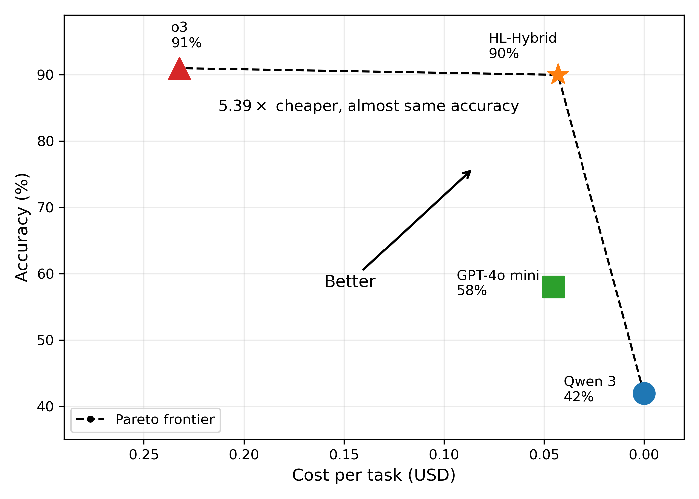

# HL-Hybrid: Reliability and Model Routing for Magentic-UI

A weak-validation + on-demand model-routing layer that lets the
[Magentic-UI](https://github.com/microsoft/magentic-ui) multi-agent web agent run on a
**local small model** (Qwen3 14B with thinking disabled, via Ollama) and borrow a cloud
model (o3) only when the local model is stuck.

> KCL Final Year Project · Final submission, August 2026



**HL-Hybrid** — the local model with this layer, borrowing o3 only when stuck — reaches
90% accuracy against o3's 91%, at 5.39× lower cost per task.

---

## Motivation

Magentic-UI (Microsoft's open-source implementation of *Magentic-One*) assumes the
backing LLM always emits **well-formed** output: structurally valid plan / progress
ledger JSON and tool-call arguments that match the executor's signature. When the
backend is swapped for a **local small model**, that assumption breaks —
mislabeled fields, a tool call written as prose, an empty plan — and the agent crashes
or spins.

This project adds a thin, mostly-**deterministic** layer on top of Magentic-UI that
catches and repairs these defects locally, and only borrows a strong cloud model when
the local model is genuinely stuck.

## Design principle

**Free-and-deterministic first, paid-and-stochastic last.**

| Mechanism | When | Cloud? | Handles |
|---|---|---|---|
| **Weak Validator** | before a tool call runs | No · deterministic | field-name drift, id coercion, a call written as prose; PASS / REPAIR / ESCALATE / SKIP, and an ESCALATE call is refused |
| **Consent Dismissal** | first visit to each URL | No · deterministic | cookie / consent banners that hide the elements the model needs; 10-second budget |
| **Text Fallback** | an explanation or answer is empty | No · deterministic | a default string instead of a blank |
| **Answer Verifier** | the last plan step claims completion | Yes · judge | a cloud judge checks the answer; a FAIL keeps the step open and routes the WebSurfer |
| **Model Routing** | sustained no-progress | Yes · decision | borrow o3 to re-decide; five escalation sources, one routing flag |

**Removed 2026-07-29.** Three mechanisms were dropped after measurement, because this
project only keeps a rule that a frequently observed error earns: an execution rescue
(reached 21 times, repaired 0), a cloud JSON rescue (never reached in 198 runs) and a
cloud text rescue (never reached in 109 opportunities). What replaced the last one is a
single default string, which covered all 64 of its real cases at zero cost.

## The weak validator in one idea

It does not enumerate "all the ways output can be wrong". It **rebuilds the output into
a single canonical form**, and the rebuild itself *is* the verdict:

```python
state = PASS if normalised_args == toolargs else REPAIR   # unchanged -> PASS, repaired -> REPAIR
# a required field that cannot be normalised (normalize_id -> None) -> ESCALATE
```

Examples (a click's `target_id`): `6` → PASS · `{"id":29}` / `"29"` → REPAIR ·
`[17,21]` / `"the blue button"` / missing → ESCALATE.

## How to run

The GPU-based setup below uses Docker, Anaconda, and an NVIDIA GPU with 16 GB of VRAM.
Make sure Docker is running before you start. Run the commands from the repository
root in PowerShell unless a step says otherwise.

### 1. Create an environment and install Magentic-UI

Creating a separate Conda environment is optional, but keeps the project dependencies
separate from your other Python environments.

```powershell
conda create -n mgui python=3.12 -y
conda activate mgui
pip install "magentic-ui[ollama]==0.1.6"
playwright install chromium
```

### 2. Install the project changes

Choose one of the following methods:

* Replace the installed `magentic_ui/` folder with this repository's
  [`src/magentic_ui/`](src/magentic_ui/) folder.
* Apply the patch and copy the new modules, following
  [`contribution/CORE_CHANGES.md`](contribution/CORE_CHANGES.md).

To find the installation directory, run:

```powershell
pip show magentic-ui
```

The installed `magentic_ui/` folder is inside the directory shown under `Location`.
In that installed folder, open `hl_config.py` and set `OPENAI_API_KEY` to your OpenAI
API key. Keep the key private; do not commit it to GitHub.

### 3. Start Ollama and prepare the local model

Start the Ollama container, download Qwen3 14B, and build the `qwen3-nothink` model:

```powershell
docker run -d --gpus all -v ollama:/root/.ollama -p 11434:11434 --name ollama -e OLLAMA_FLASH_ATTENTION=1 -e OLLAMA_KV_CACHE_TYPE=q8_0 -e OLLAMA_CONTEXT_LENGTH=32768 ollama/ollama
docker exec ollama ollama pull qwen3:14b
docker cp contribution/qwen3-nothink.Modelfile ollama:/tmp/m
docker exec ollama ollama create qwen3-nothink -f /tmp/m
```

The Modelfile is included in the repository; you do not need to create it manually.

### 4. Launch and configure the web UI

Start Magentic-UI:

```powershell
magentic-ui --port 8081
```

Open [http://localhost:8081](http://localhost:8081), then go to **Settings → Advanced
settings**. Set `model` to `qwen3-nothink` and `vision` to `false`. The relevant model
configuration is:

```yaml
model: qwen3-nothink
host: http://localhost:11434
max_retries: 5
model_info:
  vision: false
  function_calling: true
  json_output: true
  family: unknown
  structured_output: false
  multiple_system_messages: false
```

Click **Apply changes**, then start a new session to use the updated configuration.

### 5. Run tasks from the command line

As an alternative to the web UI, use the CLI. In a PowerShell terminal with the
`mgui` environment active, change from the repository root to `src/`, which contains
`eval_config.yaml`:

```powershell
cd src
$env:PYTHONIOENCODING="utf-8"
$task = "Please use Google Maps to find the walking time from King's College London's Strand Campus to Big Ben. Give the answer in minutes."
magentic-cli --work-dir ".\work_1" --config eval_config.yaml --autonomous --action-policy never --old-cli --task $task *> "run_1.log"
```

`--action-policy never` auto-approves every action, which turns off Magentic-UI's action
guard. `--autonomous` removes the user from the team, so a CAPTCHA cannot be handed off
during such a run. Use these options only for controlled test tasks.

To repeat the same task ten times, stay in `src/` and run the following instead of the
single-run command. It uses the `$task` value defined above.

**Container cleanup warning:** this example force-removes all running containers
based on `ghcr.io/microsoft/magentic-ui-browser:0.0.2` after each run. Do not use it
while other Magentic-UI browser sessions are active.

```powershell
1..10 | ForEach-Object {
    magentic-cli --work-dir ".\work_$_" --config eval_config.yaml --autonomous --action-policy never --old-cli --task $task *> "run_$_.log"
    docker ps -q --filter ancestor=ghcr.io/microsoft/magentic-ui-browser:0.0.2 | ForEach-Object {
        docker rm -f $_
    }
}
```

Each run writes a log in the current directory, from `run_1.log` to `run_10.log`.
To test a different task, replace the text assigned to `$task` before running the
command again.

### Recovering an installation

Backups of the modified modules are stored in [`src/baks/`](src/baks/). If the installed
package becomes unusable, reinstall Magentic-UI 0.1.6 and reapply the project changes
using either method in step 2. See
[`contribution/CORE_CHANGES.md`](contribution/CORE_CHANGES.md) for the list of modified
files and their locations.

## Configuration — `magentic_ui/hl_config.py`

| Key | Default | Meaning |
|---|---|---|
| `OPENAI_API_KEY` | `""` | used by routing and the answer verifier. Neither checks for an empty key, so with it empty they still attempt the cloud call. |
| `cloud_model` | `o3` | the model borrowed by routing and used by the answer verifier |
| `or_stall_limit` | 2 | repeated replan requests before the orchestrator is routed |
| `or_idle_limit` | 5 | rounds with the step still incomplete before the orchestrator is routed |
| `context_cap` | 12 | a routed call sees the first message plus the last 12 |
| `ws_stuck_route_or` | 2 | WebSurfer re-escalations that also route the orchestrator |
| `ws_noop_limit` | 2 | WebSurfer turns without an executable action before routing |
| `ws_base_steps` | 20 | cloud steps the WebSurfer may take once routed |
| `ws_extra_steps` | 15 | extra cloud steps per re-escalation |
| `or_auto_replan` | `True` | continue after a replan without waiting for the user to accept it |
| `Veri_ans` | `True` | turn the answer verifier on or off |
| `ws_loop_window` | 4 | recent WebSurfer actions the loop monitor looks at |
| `ws_loop_distinct` | 2 | at most this many distinct actions in the window counts as a loop |
| `TRACE_LOG` | next to `hl_config.py` | where `[MODEL_TRACE]` lines are appended |

## Attribution

Built on [Magentic-UI](https://github.com/microsoft/magentic-ui) by Microsoft (MIT). The
modules under `contribution/src/` are original work for a KCL FYP. See `NOTICE`.

## Repository layout

Reports are not included in this repository. The source package is available directly
under [`src/`](src/) rather than as a ZIP archive.

### Directory tree

The tree below shows the main source folder, `src/magentic_ui/`, including all eleven
files changed by this project. `[new]` and `[modified]` refer to changes relative to
Magentic-UI 0.1.6. Other upstream files and individual generated UI assets are omitted
for readability.

```text
src/magentic_ui/
├── hl_config.py                       # [new] Reliability-layer settings
├── _cli.py                            # Legacy command-line task runner
├── task_team.py                       # Agent-team setup
├── magentic_ui_config.py              # Package configuration
├── agents/
│   ├── web_surfer/
│   │   ├── _web_surfer.py             # [modified] Web agent and reliability hooks
│   │   └── _consent.py                # [new] Cookie/consent banner handling
│   ├── file_surfer/
│   ├── users/
│   └── mcp/
├── teams/
│   └── orchestrator/
│       ├── _orchestrator.py           # [modified] Task coordination and checks
│       ├── _prompts.py                # [modified] Prompts and plan validation
│       ├── _weak_validator.py         # [new] Tool-call validation and repair
│       ├── _model_rotation.py         # [new] On-demand model routing
│       └── _answer_verifier.py        # [new] Final-answer verification
├── tools/
│   ├── playwright/
│   │   ├── playwright_controller.py   # [modified] Browser-action handling
│   │   ├── page_script.js             # [modified] Page-element labels
│   │   ├── browser/
│   │   └── utils/
│   └── mcp/
├── backend/
│   ├── cli.py                         # Web UI server entry point
│   ├── database/
│   ├── datamodel/
│   ├── teammanager/
│   └── web/
│       ├── managers/
│       │   └── connection.py          # [modified] Message-content handling
│       ├── routes/
│       └── ui/                        # Bundled web UI assets
├── cli/                               # Command-line task execution
├── eval/                              # Evaluation benchmarks and runners
└── learning/
```

`src/baks/` contains flat backup copies of the project files; it is not part of the
main package structure shown above.

